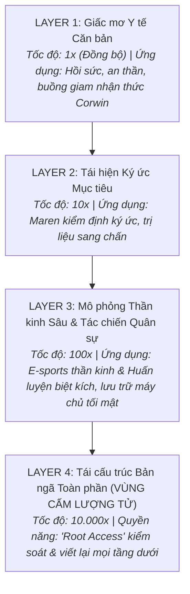

# MASTER STORY ARCHITECTURE & SERIES BIBLE
## *THE NAME THAT SURVIVED* (DỰ ÁN: LAYER 4 SERIES)

*Tài liệu Tổng hợp Cốt lõi: Quy tắc Thế giới, Công nghệ Giấc mơ, Hồ sơ Nhân vật, Sườn 4 Hồi Book 1 và Định hướng Toàn Series (Trilogy).*

---

## MỤC LỤC
1. [Thông tin Tổng quan & Định vị Thương mại](#1-thông-tin-tổng-quan--định-vị-thương-mại)
2. [Hệ thống Khoa học Giấc mơ (The 4-Layer Dream System)](#2-hệ-thống-khoa-học-giấc-mơ-the-4-layer-dream-system)
3. [Hồ sơ Nhân vật & Tuyến Mối quan hệ](#3-hồ-sơ-nhân-vật--tuyến-mối-quan-hệ)
4. [Tuyến Tình cảm & Chữa lành Tâm lý (Romance & Healing Arc)](#4-tuyến-tình-cảm--chữa-lành-tâm-lý-romance--healing-arc)
5. [Sườn Cốt truyện Chi tiết Book 1 (4 Hồi - 29 Chương)](#5-sườn-cốt-truyện-chi-tiết-book-1-4-hồi---29-chương)
6. [Hệ thống 5 Lỗ hổng & Giải pháp Vá lỗi Tuyệt đối](#6-hệ-thống-5-lỗ-hổng--giải-pháp-vá-lỗi-tuyệt-đối)
7. [Định hướng Phát triển Book 2 & Book 3 (Series Expansion)](#7-định-hướng-phát-triển-book-2--book-3-series-expansion)

---

## 1. THÔNG TIN TỔNG QUAN & ĐỊNH VỊ THƯƠNG MẠI

* **Tên tác phẩm (Working Title):** *The Name That Survived* (Cái Tên Còn Sống Sót / Tầng Thứ Tư)
* **Thể loại:** Sci-Fi Romantic Suspense / Cyber-Neural Action Thriller / Psychological Mystery.
* **Thời lượng dự kiến:** 
  * **Book 1:** 85.000 – 95.000 từ (28 Chương chính + 1 Epilogue).
  * **Series:** Bộ ba tác phẩm (Trilogy).
* **Tagline thương mại:** *"Ký ức có thể bị lập trình, nhưng tình yêu và sự hy sinh luôn thuộc về ý chí tự do."*
* **High-Concept Hook:** Một người đàn ông tỉnh dậy sau 11 ngày hôn mê vì sự cố ở Tầng 4 của giấc mơ. Anh mất sạch ký ức về bản thân, chỉ nhớ duy nhất một cái tên: *Maren*. Khi tìm thấy cô — một nữ tiến sĩ kiểm định giấc mơ đang ôm nỗi đau mất vị hôn phu trên biển — họ phát hiện trong đầu anh chứa hồ sơ một vụ thảm sát diệt khẩu 20 năm trước và những mảnh ký ức rò rỉ từ một người đàn ông được cho là đã chết.

---

## 2. HỆ THỐNG KHOA HỌC GIẤC MƠ (THE 4-LAYER DREAM SYSTEM)



### 2.1. Cơ chế Giãn nở Thời gian (Exponential Time Dilation)
* **Layer 1 ($1\times$):** 1 giờ thực tế = 1 giờ trong mơ (Đồng bộ y tế, theo dõi sinh trắc học thời gian thực).
* **Layer 2 ($10\times$):** 1 giờ thực tế = 10 giờ trong mơ (Đủ để tua lại và phân tích chi tiết một ngày ký ức).
* **Layer 3 ($100\times$):** 1 giờ thực tế = 100 giờ (~4 ngày) trong mơ (Dùng cho huấn luyện phản xạ tác chiến quân sự và giải đấu E-sports thần kinh).
* **Layer 4 ($10.000\times$ - Phi tuyến tính):** 3 giờ thực tế trong phòng lab = **18–20 NĂM một đời người giả lập** trong tâm trí.

### 2.2. Cơ chế Tự vệ của Não bộ Elias trong Layer 4 (The Idyllic Sandbox)
* Khi bị ép vào Layer 4 ở đầu truyện, để tránh nổ tung vì đại hồng thủy dữ liệu, não Elias tự kích hoạt "Bong bóng giả lập 20 năm": Anh trải qua một tuổi thơ êm đềm, có cha có mẹ (dù thực tế là trẻ mồ côi bị thí nghiệm).
* Khi ảo mộng nứt vỡ, anh thức tỉnh và bị **Tự đào thải khẩn cấp (Emergency Ejection)**, gây ra cơn hôn mê 11 ngày và xóa sạch ký ức về cuộc đời giả lập, chỉ còn sót lại duy nhất cái tên **MAREN**.

### 2.3. Cơ chế Rò rỉ Ký ức (Quantum Neural Entanglement)
* Não bộ trong mạng lưới định tuyến theo **Mỏ neo Cảm xúc (Emotional Anchor)**. Vì cả Elias (trong tiềm thức sâu) và Corwin (đang bị giam ở Layer 1) đều hướng về **"Maren Solis"**, hai dòng tín hiệu này đã va chạm và hút lẫn nhau, khiến Elias mang theo các mảnh ký ức về biển của Corwin khi tỉnh dậy.

### 2.4. Di chứng Sinh học của Elias (Neural Thermal Burnout)
* Ép xung Layer 4 làm tổn thương vi mạch máu não: gây chảy máu cam, đau nửa đầu dữ dội (Neural Spikes) và chớp mắt ảo giác.
* **Quy luật sinh tử:** Elias bị cấm kích hoạt Layer 4 lần nữa nếu không muốn bị xuất huyết não toàn phần dẫn đến tử vong hoặc sống thực vật.

---

## 3. HỒ SƠ NHÂN VẬT & TUYẾN MỐI QUAN HỆ

```mermaid
graph TD
    subgraph "PHE PHẢN KHÁNG (PROTAGONISTS)"
        Elias["ELIAS VANE (29t)<br>Subject Zero / Não bộ thiên tài bẩm sinh<br>Cao thủ Neuro-Gaming / Mang di chứng Layer 4"]
        Maren["DR. MAREN SOLIS (31t)<br>Chuyên gia kiểm định giấc mơ hàng đầu<br>Con gái nhà khoa học Elena đã hy sinh"]
        Corwin["CORWIN DALY (32t)<br>Vị hôn phu của Maren / Nhà báo điều tra<br>Bị giam ở Layer 1 ngoài đảo"]
        Hacker["NỮ HACKER DARK WEB<br>Đồng minh bí mật của Corwin<br>Hỗ trợ công nghệ Book 1 / Nữ chính Book 2"]
        Squad["HỘI BẠN GAME (Neuro-Gaming Squad)<br>Tình bạn ảo nhưng sống chết có nhau<br>Đồng đội tác chiến Layer 3"]
    end

    subgraph "PHE PHẢN DIỆN (ANTAGONISTS)"
        Halloway["DR. IRIS HALLOWAY<br>Viện trưởng tại thành phố (Phản diện Book 1)"]
        Coalition["TỔ HỢP QUÂN SỰ / SIÊU CƯỜNG QUỐC GIA<br>Thế lực ngầm muốn dùng Layer 4 kiểm soát nhân loại (Phản diện Book 2 & 3)"]
    end

    Elias <-->|Đồng cam cộng khổ -> Tình yêu đích thực| Maren
    Corwin -.->|Hôn phu cũ (Khép lại quá khứ)| Maren
    Corwin <-->|Ghép đôi & Giải cứu ở Book 2| Hacker
    Elias <-->|Anh em sinh tử| Squad
    Halloway -->|Tay sai điều hành| Coalition
```

### 3.1. Nhân vật Chính (Protagonists)
* **Elias Vane (29 tuổi):** "Subject Zero" – người duy nhất sống sót qua thử nghiệm nguyên mẫu Layer 3 năm 7 tuổi. Bị cấy ký ức tội lỗi giả làm đổ nến gây cháy suốt 20 năm. Sống khép kín, là cao thủ trong game thần kinh. Người hùng hy sinh kích hoạt Layer 4 ở trận cuối để cứu Maren.
* **Dr. Maren Solis (31 tuổi):** Con gái của Elena Solis (nhà khoa học phản tỉnh bị thiêu chết 20 năm trước). Được bố mẹ Corwin bí mật nhận nuôi. Chuyên gia kiểm định giấc mơ sống bằng lý tính và dữ liệu. Mang nỗi đau dằn vặt vì sự mất tích của vị hôn phu Corwin.
* **Corwin Daly (32 tuổi):** Con trai người cảnh sát năm xưa đã cứu Maren. Tiếp nối cha mẹ điều tra Viện Halloway để trả lại sự thật cho Maren. Dùng cơ chế Zero-Knowledge gửi dữ liệu cho Nữ Hacker rồi bị Halloway gài bẫy giam ở Layer-1 ngoài đảo.
* **Nữ Hacker Dark Web:** Thiên tài công nghệ ẩn danh. Nhận ủy thác dữ liệu từ Corwin. Vị cứu tinh từ xa trong trận chiến Book 1, người dẫn dắt chiến dịch giải cứu Corwin ở Book 2 và nảy sinh tình cảm chân chính với Corwin.
* **Hội Bạn Game của Elias (The Neuro-Gaming Squad):** 2–3 người bạn thân ảo của Elias trong không gian mạng thần kinh. Tình bạn ảo nhưng gắn kết chân thành; sẵn sàng đăng nhập Layer 3 liều mạng tác chiến bảo vệ Elias và trở thành đồng đội nòng cốt ra đảo ở Book 2.

### 3.2. Nhân vật Phản diện (Antagonists)
* **Dr. Iris Halloway (50s):** Viện trưởng Tập đoàn Halloway tại thành phố. Kẻ thủ tiêu mẹ Maren và cấy ký ức giả vào Elias 20 năm trước. Đại diện cho sự tự phụ khoa học và lòng tham quyền lực.
* **Tổ Hợp Quân Sự / Siêu Cường Quốc Gia (The Global Shadow Coalition):** Thế lực ngầm đứng sau tài trợ dự án Mnemosyne, âm mưu độc quyền chiếm đoạt Layer 4 để tạo vũ khí thao túng nhận thức và định hình trật tự thế giới mới (Phản diện tối cao của Book 2 và Book 3).

---

## 4. TUYẾN TÌNH CẢM & CHỮA LÀNH TÂM LÝ (ROMANCE & HEALING ARC)

Tình cảm giữa Elias và Maren được xây dựng theo cấu trúc **Slow-Burn & Chữa lành Thực tế**, qua 4 nấc thang cảm xúc:

1. **Nấc thang 1 (Hồi 1) — Chuyên gia & Thân chủ:** Maren giữ khoảng cách chuyên nghiệp, tôn trọng ranh giới; Elias tìm thấy sự an toàn khi Maren không coi anh là quái vật.
2. **Nấc thang 2 (Đầu Hồi 2) — Đồng cảm & Sự chăm sóc thể xác/tâm hồn:** Trong những đêm chạy trốn, Maren tận tụy chăm sóc các cơn đau đầu, chảy máu cam của Elias. Elias cảm nhận được hơi ấm gia đình thật sự và âm thầm rung động trước cô.
3. **Nấc thang 3 (Giữa Hồi 2) — Nghi thức Buông bỏ ở Bờ biển:**
   * Maren dằn vặt trước biển vì cảm giác có tội nếu tiếp tục sống và hạnh phúc trong khi Corwin đã mất.
   * Elias chân thành giải thoát cô khỏi bóng ma quá khứ: *"Corwin yêu em là để em được sống hạnh phúc, không phải để em thành bóng ma chìm dưới đáy biển"*.
   * Maren khóc nức nở, trút bỏ gánh nặng 8 tháng và xem Elias là tri kỷ lớn nhất đời mình. Maren vẫn chưa nhận ra tình cảm mới, trong khi Elias yêu cô sâu sắc mà không hề đòi hỏi.
4. **Nấc thang 4 (Cuối Hồi 3) — Khoảnh khắc Giác ngộ & Lời tỏ tình Sinh tử:**
   * Khi Elias chuẩn bị kích hoạt Layer 4 hy sinh tính mạng, Maren đập kính gào khóc: *"Em yêu anh, Elias! Đừng chết, hãy sống sót quay về với em!"*.
   * Lời tỏ tình trở thành mỏ neo ý chí sinh tồn, giúp Elias bùng nổ sức mạnh Layer 4, giành chiến thắng vĩ đại trước khi rơi vào hôn mê sâu.

---

## 5. SƯỜN CỐT TRUYỆN CHI TIẾT BOOK 1 (4 HỒI - 29 CHƯƠNG)

### 🔴 HỒI 1: TỈNH THỨC, KHÁM BỆNH & BÍ MẬT BỊ PHƠI BÀY (Chương 1 – 7)
* **Ch 1:** Elias tỉnh dậy sau 11 ngày hôn mê tại Halloway Medical. Não anh xóa sạch 20 năm giả lập trong Layer 4, chỉ còn sót lại duy nhất cái tên: *Maren*.
* **Ch 2–3:** Elias xuất viện, lần theo cái tên và tìm đến phòng kiểm định của Tiến sĩ Maren Solis. Maren tiếp nhận ca bệnh với tư cách bác sĩ kiểm định một trường hợp mất trí nhớ dị biệt.
* **Ch 4–5:** Các phiên quét sóng não Layer 2 bắt đầu. Maren phát hiện Elias không nói dối. Elias bắt đầu rò rỉ những mảnh ký ức lạ (mùi oải hương, lá thư thoại, vụ cháy). Giới thiệu hội bạn game qua những giờ giải trí đời thường của Elias.
* **Ch 6:** Căng thẳng thể chế. Dr. Halloway liên tục gọi điện ép Elias quay lại Viện nhưng anh từ chối.
* **Ch 7 (Bước ngoặt Hồi 1 - The Breach & Raid):**
  * Trong phiên quét sâu, não Elias giải mã ra **Hồ sơ đen 20 năm trước**: Lệnh thiêu hủy cơ sở và diệt khẩu Elena Solis (mẹ Maren) do Halloway ký, cùng mã số "Subject Zero" của Elias bị cấy ký ức giả.
  * Báo động đỏ Viện Halloway kích hoạt. Đội biệt kích Halloway ập đến đốt phá phòng lab.
  * Maren kịp giật ổ cứng và cùng Elias thoát thân qua lối thoát hiểm trong đêm mưa.

### 🟡 HỒI 2A: CUỘC CHẠY TRỐN & DẤU VẾT THẦN KINH (Chương 8 – 14)
* **Ch 8–9:** Maren và Elias ẩn náu tại các nhà trọ ven đô. Truyền hình phát lệnh truy nã Elias (vu khống anh bắt cóc Maren).
* **Ch 10–11:** Maren dùng bộ vali y tế dã chiến trong cốp xe để thiết lập máy quét lưu động. Elias vào Layer 2/3 để truy vết máy chủ Halloway.
* **Ch 12–13 (Cài cắm Trạm Đảo Sinh Thái & Di chứng):** 
  * Elias bị sốc nhiệt não, chảy máu cam dữ dội. 
  * Maren kiểm tra dữ liệu và phát hiện tài liệu về **"Trạm Đảo Sinh Thái (Sanctuary Node)"** — nơi có Buồng Tái tạo Lượng tử duy nhất có thể cứu mạng Elias.
* **Ch 14 (Midpoint):** Elias kết nối với **Hội Bạn Game**. Anh tâm sự thật về cuộc chạy trốn và hoàn cảnh ngặt nghèo của mình. Hội bạn game tuyên bố: *"Anh em là anh em, sẵn sàng tiếp ứng khi cần!"*

### 🟢 HỒI 2B: CHỮA LÀNH BỜ BIỂN & RUNG ĐỘNG NGẦM (Chương 15 – 21)
* **Ch 15–16:** Cả hai chạy trốn đến một trạm tiếp sóng/hải đăng cũ ven biển (gần vùng biển Corwin mất tích).
* **Ch 17 (Nghi thức buông bỏ ở Bờ biển):** Maren dằn vặt trước biển; Elias chân thành giúp cô cởi bỏ mặc cảm tội lỗi về Corwin. Maren khép lại quá khứ trong bình yên.
* **Ch 18–19:** Sự chăm sóc tận tụy của Maren khi Elias lên cơn đau đầu. Tình cảm của Maren bắt đầu chuyển hóa trong tiềm thức.
* **Ch 20–21:** Chuẩn bị cho trận đánh cuối: Đột kích máy chủ quân sự Layer 3 của Viện từ ngọn hải đăng để phát tán hồ sơ tội ác ra toàn cầu.

### 🔵 HỒI 3: ĐẠI CHIẾN KÉP & ĐÁNH ĐỔI SINH TỬ (Chương 22 – 28)
* **Ch 22–23 (Mở màn trận đánh):** Elias vào lồng máy quét lặn xuống Layer 3. Maren làm hoa tiêu giữ nhịp tim. Đội an ninh Viện mang quân và **Phi đội Drone** bao vây ngọn hải đăng.
* **Ch 24 (Nữ Hacker xuất trận ngoài đời):** Nữ Hacker Dark Web hack chiếm quyền điều khiển Drone bắn ngược quân Viện, ngắt vũ khí thông minh của lính Viện và gọi cảnh sát vũ trang (SWAT) ập tới.
* **Ch 25–26 (Trận chiến trong mơ & Hội bạn game):** Trong Layer 3, Elias cùng Hội bạn game đụng độ Lực lượng Biệt kích Thần kinh của Viện. Hội bạn game tử thủ yểm trợ cho Elias.
* **Ch 27 (Tỏ tình & Thức tỉnh Layer 4):**
  * Elias chuẩn bị mở Layer 4 hy sinh. Maren đập kính gào khóc tỏ tình qua mic.
  * Elias bùng nổ **Layer 4 Reality Override**: Ghi đè hệ thống Layer 3, tiêu diệt lính Viện, đoạt dữ liệu gốc và phát tán ra toàn cầu!
* **Ch 28 (Chiến thắng & Hậu quả):** Dr. Halloway bị bắt sống tại trụ sở. Elias rơi vào trạng thái suy kiệt thần kinh nguy kịch. Maren ôm anh và thề sẽ đưa anh ra Trạm Đảo Sinh Thái để cứu sống anh.

### 🟣 EPILOGUE (Chương 29): CÚ TWIST MỞ MÀN BOOK 2
* **Cảnh 1:** Tại Trạm Đảo Sinh Thái biệt lập ngoài biển, bên trong buồng kén Layer-1, **Corwin Daly thở dốc và mở mắt**.
* **Cảnh 2:** Màn hình Nữ Hacker nhấp nháy: `[ALERT: TÍN HIỆU CORWIN DALY ĐÃ KÍCH HOẠT. BẮT ĐẦU CHIẾN DỊCH GIẢI CỨU]`.
* Nữ Hacker gửi tin nhắn thoại cho Maren: *"Hẹn gặp cô ngoài biển lớn."*
* 👉 **HẾT BOOK 1!**

---

## 6. HỆ THỐNG 5 LỖ HỔNG & GIẢI PHÁP VÁ LỖI TUYỆT ĐỐI

| Lỗ hổng tiềm ẩn | Nguy cơ logic nếu không xử lý | GIẢI PHÁP VÁ LỖI CHÍNH THỨC |
| :--- | :--- | :--- |
| **1. Thả tự do Elias sau hôn mê** | Viện nghiên cứu nguy hiểm mà quản lý bệnh nhân lỏng lẻo? | Halloway cố tình thả để làm mồi câu (Honeypot) theo dõi sóng não từ xa nhằm trích xuất dữ liệu tự nhiên. |
| **2. Chỉ hút đúng ký ức Corwin** | Trùng hợp ngẫu nhiên khiên cưỡng giữa hàng triệu người? | Cơ chế Mỏ neo Cảm xúc (Emotional Anchor Tag): Cả Elias và Corwin đều hướng về từ khóa "Maren Solis". |
| **3. Maren không bị diệt khẩu từ nhỏ** | Con gái kẻ phản bội tại sao lớn lên bình yên? | Bố mẹ Corwin làm giả hồ sơ Maren đã chết trong đám cháy, bí mật nhận nuôi và đổi họ thời thơ ấu. |
| **4. Tại sao không giết quách Corwin** | Bắt được rồi sao không giết diệt khẩu mà giam Layer 1? | Corwin gửi dữ liệu cho Nữ Hacker theo cơ chế Zero-Knowledge; Viện không tra khảo được nên phải giữ sống. |
| **5. Di chứng Layer 4 & Áp lực thời gian** | Mất trí nhớ kiểu Memento dễ làm nhân vật đơ và sáo mòn? | Thay bằng Hội chứng Quá tải Nhiệt Thần kinh (Thermal Burnout): Chảy máu cam, đau đầu, cấm mở Layer 4 kẻo đột quỵ. |

---

## 7. ĐỊNH HƯỚNG PHÁT TRIỂN BOOK 2 & BOOK 3 (SERIES EXPANSION)

### 🚢 BOOK 2: *THE SANCTUARY NODE* (Trạm Đảo Sinh Thái)
* **Xung đột 1 (Hải trình Sinh tử):** Maren, Elias (đang hôn mê yếu ớt), Nữ Hacker và Hội Bạn Game lập thành một đội vượt biển đột nhập hòn đảo bí mật.
* **Xung đột 2 (Giải thoát & Tình cảm):** 
  * Cứu sống Elias bằng Buồng Tái sinh Lượng tử.
  * Đánh thức Corwin. Corwin và Nữ Hacker trải qua sinh tử cùng nhau và nảy sinh tình cảm sâu sắc (Hacker x Corwin).
  * Maren và Corwin có cuộc đối thoại chân thành của hai người trưởng thành, chúc phúc cho nhau bước tiếp.
* **Kẻ thù lộ diện:** Phát hiện Trạm Đảo này thuộc quyền kiểm soát của **Tổ Hợp Quân Sự Toàn Cầu**.

### 🌐 BOOK 3: *THE SOVEREIGN MIND* (Trận Chiến Tự Do Ý Chí)
* **Quy mô:** Toàn cầu (Địa chính trị & Chiến tranh Thần kinh).
* **Nội dung:** Liên minh 5 người (Elias, Maren, Corwin, Nữ Hacker, Hội Bạn Game) lãnh đạo cuộc chiến phá hủy Siêu máy chủ Layer 4 toàn cầu, giải phóng nhân loại khỏi âm mưu thao túng tâm trí, bảo vệ quyền tự do ý chí vĩnh viễn.

---
*Tài liệu này được lưu trữ làm Kim Chỉ Nam Chính Thức cho toàn bộ quá trình sáng tác và chuyển thể.*
