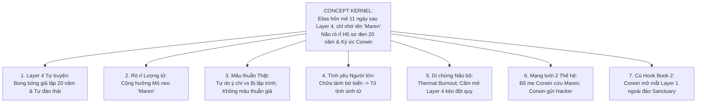
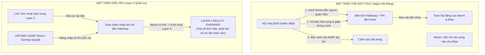
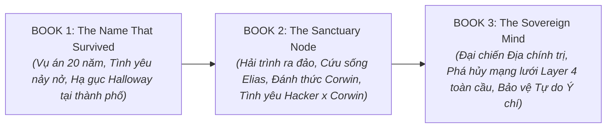

> ⚠️ **ĐÃ CŨ (11/2026):** cốt truyện, thông số các tầng giấc mơ và tuyến tình cảm trong file này đã được thay bằng `CANON_V2_CAI_TEN_CON_SONG_SOT.md` và `DAN_Y_TAP1_V2.md`. Khi có mâu thuẫn, theo CANON V2.

# FULL MASTER PHASES UNIFIED (CANON V4)
## *THE NAME THAT SURVIVED* (DỰ ÁN: LAYER 4 TRILOGY)

*Tài liệu Hợp nhất Toàn diện: Tích hợp đầy đủ Phase 7 (Craft Bible), Phase 8A (Concept Architecture), Phase 8B (Story Architecture), Phase 9 (Granular 29-Chapter Blueprint & Hook Engineering) và Phase 10-12 (Drafting & Quality Diagnostics) thành MỘT FILE DUY NHẤT chuẩn hóa theo cấu trúc mới nhất.*

---

# MỤC LỤC
1. [PHASE 7 — MASTER WRITING BIBLE & CRAFT PHILOSOPHY](#phase-7--master-writing-bible--craft-philosophy)
2. [PHASE 8A — MASTER CONCEPT ARCHITECTURE (CANON V4)](#phase-8a--master-concept-architecture-canon-v4)
3. [PHASE 8B — STORY ARCHITECTURE & DUAL-FRONT ENGINE](#phase-8b--story-architecture--dual-front-engine)
4. [PHASE 9 — GRANULAR 29-CHAPTER SCENE & HOOK BLUEPRINT](#phase-9--granular-29-chapter-scene--hook-blueprint)
5. [PHASE 10 & 11 — PROSE EXECUTION & QUALITY DIAGNOSTICS](#phase-10--11--prose-execution--quality-diagnostics)
6. [PHASE 12 — SERIES EXPANSION (BOOK 2 & BOOK 3 ROADMAP)](#phase-12--series-expansion-book-2--book-3-roadmap)

---

# PHASE 7 — MASTER WRITING BIBLE & CRAFT PHILOSOPHY

### 1.1. Nguyên Lý Tối Thượng (The Governing Principle)
* **QUY TẮC LÀ CÔNG CỤ, KHÔNG PHẢI LUẬT PHÁP (Rules are tools, not laws).**
* Không bao giờ thỏa mãn một quy tắc viết văn nếu nó làm tổn hại đến:
  - Sự chân thật của nhân vật (*Character Truth*).
  - Tính hợp lý của mạch truyện (*Narrative Coherence*).
  - Độ tin cậy của cảm xúc (*Emotional Credibility*).
  - Trải nghiệm lôi cuốn của độc giả (*Reader Engagement & Pacing*).

### 1.2. Công Thức Tính Tự Nhiên (The Formula for Naturalness)
$$\text{Naturalness} = \text{A specific mind under specific pressure}$$
*(Sự tự nhiên = Một tâm trí cụ thể dưới một áp lực cụ thể)*
* Tuyệt đối không dùng văn phong mượt mà nhưng vô hồn. Trước mỗi quyết định viết, luôn tự hỏi:
  - Nhân vật NÀY sẽ chú ý đến điều gì? Bỏ qua điều gì?
  - Nhân vật NÀY sẽ hiểu lầm điều gì? Từ chối nói ra điều gì?
  - Cơ thể và hệ thần kinh của nhân vật NÀY phản ứng ra sao trước khi lý trí kịp nhận thức?

### 1.3. Nghệ Thuật Kéo Trang Thương Mại (Hook Engineering Framework)
* **Kỹ thuật Mở đầu Chương (Opening Hooks):** Tuyệt đối tránh mở đầu bằng "trạng thái tĩnh" (nhìn trời mưa, ngồi pha trà, trầm ngâm). Áp dụng **In Medias Res** (Vào giữa hành động):
  1. *Action Disruption:* Mở đầu bằng một hành động đang dở dang hoặc biến cố bất ngờ ập đến.
  2. *Provocative Contradiction:* Một phát hiện khoa học/dữ liệu tự vỗ mặt điều vừa tin tưởng.
  3. *Embodied Shock:* Phản xạ cơ thể (tim đập, khó thở, mùi cháy) xuất hiện trước khi nhân vật hiểu chuyện gì xảy ra.
* **Kỹ thuật Kết thúc Chương (Ending Page-Turners):** Tuyệt đối không kết chương bằng một tiếng thở dài buông xuôi. Áp dụng 5 kiểu mồi câu:
  1. *The Unanswered Reveal:* Hé lộ một nửa sự thật làm đảo lộn giả thuyết cũ.
  2. *The Sudden Intrusion:* Tiếng gõ cửa lúc 3h sáng / Đội an ninh ập tới / Tín hiệu cảnh báo đỏ.
  3. *The Ticking Clock:* Thời hạn chót sinh tử được kích hoạt.
  4. *The Emotional Vulnerability Spike:* Lời thú nhận bùng nổ xé toạc lớp vỏ phòng vệ.
  5. *The Line of No Return:* Một quyết định hành động không còn đường lui.

---

# PHASE 8A — MASTER CONCEPT ARCHITECTURE (CANON V4)

### 2.1. Bảy Trụ Cột Chịu Lực Bất Di Bất Dịch (The 7 Load-Bearing Pillars)
1. **Layer 4 là Tái cấu trúc Tự truyện, không phải cõi ngoại cảm dùng chung:** Elias sống 20 năm giả lập trong chính tiềm thức của mình; sự rò rỉ là do cộng hưởng dữ liệu trên máy chủ.
2. **Cơ chế Mỏ neo Cảm xúc (Emotional Anchor Tag):** Tín hiệu của Corwin (ở Layer 1) và Elias (ở Layer 4) hút nhau vì cả hai cùng chứa từ khóa cảm xúc tối thượng: *"Maren Solis"*.
3. **Ký ức làm phức tạp tình yêu, không tạo ra tình yêu:** Tình cảm giữa Elias và Maren sinh ra từ sự va chạm, đồng cam cộng khổ và chữa lành ở hiện tại (29 & 31 tuổi), hoàn toàn không có chuyện "thanh mai trúc mã hẹn ước từ bé".
4. **Maren khép lại quá khứ Corwin trước khi yêu Elias:** Cuộc đối thoại giải thoát tội lỗi ở bờ biển giúp Maren bình yên khép lại chương cũ; tình cảm với Elias là sự tự do của người trưởng thành.
5. **Di chứng Quá tải Nhiệt Thần kinh (Neural Thermal Burnout):** Mở Layer 4 làm tổn thương vi mạch não; Elias bị đau đầu, chảy máu cam và bị đe dọa đột quỵ nếu mở lại Layer 4.
6. **Mối nối 2 Thế hệ chặt chẽ:** Bố mẹ Corwin cứu Maren trong vụ cháy 20 năm trước; Corwin tiếp nối điều tra và gửi dữ liệu ẩn danh cho Nữ Hacker Dark Web trước khi bị bắt vào Layer-1.
7. **Kết thúc Book 1 bằng Chiến thắng Kép + Epilogue Corwin:** Hạ gục Dr. Halloway tại thành phố + Epilogue Corwin tỉnh lại trong Layer-1 ngoài đảo Sanctuary, mở màn cho Book 2.

### 2.2. Vật Lý 4 Tầng Giấc Mơ & Hệ Số Giãn Nở Thời Gian
* **LAYER 1 (1x - Đồng bộ):** Sóng Alpha/Theta nhẹ. Dùng hồi sức y tế, an thần, nơi giam giữ Corwin.
* **LAYER 2 (10x):** Sóng Theta sâu. 1 giờ thực = 10 giờ mơ. Maren dùng kiểm định ký ức.
* **LAYER 3 (100x):** Sóng Delta/Gamma. 1 giờ thực = 100 giờ (~4 ngày) mơ. Huấn luyện tác chiến quân sự ngầm & Thể thao điện tử thần kinh (Neuro-Gaming).
* **LAYER 4 (10.000x - Phi tuyến tính):** Siêu sóng Gamma vô hạn. 3 giờ thực tế ở phòng lab = **18–20 NĂM một đời người giả lập** trong tâm trí. Quyền năng tối thượng: *Reality Override* (viết lại quy tắc các tầng dưới).

---

# PHASE 8B — STORY ARCHITECTURE & DUAL-FRONT ENGINE

### 3.1. Phân Bổ 4 Hồi Chuẩn Cấu Trúc Thương Mại (4-Act Distribution)

| Hồi (Act) | Các Chương | Số từ ước tính | Trọng tâm & Xung đột chính |
| :--- | :--- | :--- | :--- |
| **Act 1** | Ch 1 – 7 | ~22.000 từ | Tỉnh thức $\rightarrow$ Tìm kiếm $\rightarrow$ Khám bệnh $\rightarrow$ Giải mã Hồ sơ đen $\rightarrow$ Đột kích phòng lab. |
| **Act 2A** | Ch 8 – 14 | ~24.000 từ | Chạy trốn $\rightarrow$ Quét não dã chiến $\rightarrow$ Cài cắm Đảo Sanctuary $\rightarrow$ Tâm sự Hội bạn game. |
| **Act 2B** | Ch 15 – 21 | ~24.000 từ | Ẩn náu Hải đăng $\rightarrow$ Chữa lành bờ biển $\rightarrow$ Tình cảm ngầm $\rightarrow$ Lên kế hoạch đột kích. |
| **Act 3** | Ch 22 – 28 | ~22.000 từ | Đại chiến Kép $\rightarrow$ Hacker diệt Drone $\rightarrow$ Bạn game tác chiến $\rightarrow$ Mở Layer 4 $\rightarrow$ Bắt Halloway. |
| **Epilogue**| Ch 29 | ~3.000 từ | Corwin mở mắt tại Đảo Sanctuary $\rightarrow$ Hacker kích hoạt chiến dịch giải cứu Book 2. |

### 3.2. Cơ Chế Tác Chiến Kép tại Cao Trào Hồi 3 (Dual-Front Climax)

---

# PHASE 9 — GRANULAR 29-CHAPTER SCENE & HOOK BLUEPRINT

---

### 🔴 ACT ONE: TỈNH THỨC, KHÁM BỆNH & BÍ MẬT PHƠI BÀY (Chương 1 – 7)

#### Chương 1: Sự Tỉnh Thức (POV: Elias)
* **Scene Goal:** Elias tỉnh dậy sau 11 ngày hôn mê, đấu tranh tìm lại nhân dạng trong một thế giới xa lạ.
* **Opening Hook (In Medias Res):** Ánh đèn huỳnh quang chói lòa và mùi đồng tanh tưởi trong miệng. Tiếng máy đo tim đập điên cuồng. Elias không biết mình là ai, nhưng trong ngực anh, bốn chữ cái cháy rực như vết sẹo: *Maren*.
* **Key Beats:** Y tá xuất hiện; Elias nhận ra mình mất sạch ký ức về 20 năm giả lập; anh chỉ biết mình tên Elias Vane và có một cái tên duy nhất phải tìm.
* **Ending Page-Turner:** Elias nhìn trộm hồ sơ bệnh án khi y tá quay lưng: Dòng chữ đỏ dán trên tập hồ sơ ghi rõ: *"ĐỐI TƯỢNG LAYER 4 - GIÁM SÁT ĐẶC BIỆT THEO LỆNH DR. HALLOWAY"*.

#### Chương 2: Cuộc Lùng Sục (POV: Elias)
* **Scene Goal:** Elias bí mật xuất viện và truy tìm danh tính của người phụ nữ mang tên Maren.
* **Opening Hook:** Elias bước ra khỏi cổng bệnh viện trong cơn mưa phùn lạnh ngắt, nhận ra có một chiếc sedan đen đang đỗ từ xa theo dõi mình.
* **Key Beats:** Anh dùng kỹ năng máy tính tra cứu cơ sở dữ liệu y khoa; tìm ra Tiến sĩ Maren Solis — Chuyên gia kiểm định ký ức độc lập. Giới thiệu chiếc điện thoại cũ chứa nhóm chat game với những người bạn ảo.
* **Ending Page-Turner:** Elias đứng trước tòa nhà văn phòng của Maren, bàn tay run rẩy chạm vào tấm biển đồng: *"Dr. Maren Solis – Dream Verification Clinic"*. Tim anh đập loạn nhịp như thể cơ thể đã nhận ra cô từ kiếp trước.

#### Chương 3: Văn Phòng Kiểm Định (POV: Maren)
* **Scene Goal:** Thể hiện sự chuyên nghiệp, sắc sảo và vết thương lòng kín đáo của Maren.
* **Opening Hook:** Maren xem xét bản quét sóng não của một ca bệnh gian lận bảo hiểm, lạnh lùng chỉ ra điểm ngụy tạo ký ức chỉ sau 30 giây quan sát biểu đồ.
* **Key Beats:** Bạn thân Nia nhắc Maren về việc ăn uống và khuyên cô nên thôi dằn vặt về Corwin; Maren nhìn chiếc nhẫn đính hôn trên ngón tay, nỗi đau mất tích 8 tháng vẫn như mới ngày hôm qua.
* **Ending Page-Turner:** Tiếng chuông cửa vang lên. Một người đàn ông cao gầy với đôi mắt trũng sâu bước vào: *"Tôi tên là Elias Vane. Tôi vừa tỉnh dậy sau 11 ngày hôn mê... và não tôi chỉ còn duy nhất tên của cô."*

#### Chương 4: Phiên Khám Đầu Tiên & Phản Xạ Cơ Thể (POV: Maren)
* **Scene Goal:** Maren kiểm tra Elias, xuất hiện hiện tượng "nhận thức cơ thể" (Embodied Recognition).
* **Opening Hook:** Mùi hương xà phòng thông thoảng và nhịp thở của Elias khiến da gà toàn thân Maren dựng đứng ngay khi cô gắn điện cực lên thái dương anh.
* **Key Beats:** Maren quét sóng não Layer 2; dữ liệu cho thấy Elias không hề giả vờ; một cảm giác quen thuộc vô lý xâm chiếm Maren khi nghe giọng nói trầm tĩnh của anh. Maren đồng ý tiếp nhận ca bệnh.
* **Ending Page-Turner:** Bản quét Layer 2 hiển thị một dòng ký ức đáy biển sâu chập chờn — dải sóng mang đúng tần số giọng nói của vị hôn phu Corwin!

#### Chương 5: Mảnh Vỡ Trồi Lên (POV: Elias)
* **Scene Goal:** Elias bắt đầu nhớ lại những chi tiết vụn vỡ và tiếp xúc với thế giới game thần kinh.
* **Opening Hook:** Cơn đau nửa đầu đầu tiên ập đến lúc nửa đêm như một mũi khoan cắm vào sau gáy Elias. Máu mũi bắt đầu rỉ từng giọt xuống bàn phím.
* **Key Beats:** Elias đăng nhập vào Layer 3 chơi game cùng 3 người bạn thân ảo (The Squad) để xoa dịu thần kinh; anh kể cho họ nghe về những mảnh ký ức kỳ lạ (mùi oải hương khô, một vết bỏng, tiếng còi báo động).
* **Ending Page-Turner:** Tin nhắn từ Dr. Halloway gửi đến điện thoại Elias: *"Chúng tôi biết cậu đang ở với ai. Tránh xa Maren Solis ra nếu cậu còn muốn giữ mạng sống."*

#### Chương 6: Áp Lực Thể Chế (POV: Maren)
* **Scene Goal:** Viện Halloway gây sức ép buộc Maren giao nộp hồ sơ bệnh án của Elias.
* **Opening Hook:** Hai luật sư mặc vest đen của Tập đoàn Halloway ngồi sẵn trong phòng chờ của Maren với một lệnh yêu cầu chuyển giao bệnh nhân có chữ ký của Hội đồng Y khoa.
* **Key Beats:** Maren kiên quyết từ chối dựa trên quyền bảo mật y khoa; cô nhận ra Halloway đang hoảng loạn muốn che giấu điều gì đó về Elias. Maren gọi Elias đến phòng lab gấp ngoài giờ làm việc.
* **Ending Page-Turner:** Maren khóa trái cửa phòng lab lúc 9 giờ tối, chuẩn bị cỗ máy quét sâu: *"Tối nay, chúng ta sẽ mở toàn bộ các lớp dữ liệu bị khóa trong đầu anh."*

#### Chương 7: Cú Đột Kích & Bắt Đầu Chạy Trốn (POV: Maren / Elias chuyển giao)
* **Scene Goal:** Giải mã Hồ sơ đen 20 năm, kích hoạt báo động và trốn chạy khỏi cuộc đột kích.
* **Opening Hook (Cú sốc giải mã):** Màn hình máy chủ của Maren nhảy mã xanh liên tục, hiển thị một tài liệu bị niêm phong 20 năm: **Lệnh thiêu hủy cơ sở & Diệt khẩu Elena Solis do chính Dr. Iris Halloway ký tên**.
* **Key Beats:** Mã số "Subject Zero" hiện lên trùng khớp với Elias; Maren bàng hoàng nhận ra mẹ mình bị sát hại và Elias là nạn nhân bị cấy ký ức giả; còi báo động mạng kêu inh ỏi.
* **Ending Page-Turner (The Raid):** Tiếng kính vỡ toang ở tầng trệt. Ba quả lựu đạn khói ném vào sảnh. Elias kéo Maren giật phăng ổ cứng, trèo qua cửa sổ thoát hiểm xuống hẻm tối giữa tiếng súng nổ rát mặt!

---

### 🟡 ACT TWO-A: CHẠY TRỐN, QUÉT NÃO DÃ CHIẾN & TÌNH BẠN (Chương 8 – 14)

#### Chương 8: Đêm Mưa Ven Đô (POV: Elias)
* **Scene Goal:** Cả hai trốn vào một nhà nghỉ tồi tàn, đối diện với cú sốc bị truy nã.
* **Opening Hook:** Bản tin truyền hình 24h giật tít đỏ: *"TRUY NÃ ĐẶC BIỆT: Bệnh nhân tâm thần nguy hiểm Elias Vane bắt cóc Tiến sĩ Maren Solis và phóng hỏa phòng khám y tế."*
* **Key Beats:** Elias nhìn Maren trong bóng tối phòng trọ; anh cảm thấy tội lỗi vì kéo cô vào nguy hiểm; Maren khẳng định cô đi theo anh vì sự thật về mẹ cô, không phải vì bị ép buộc.
* **Ending Page-Turner:** Elias lên cơn co giật dữ dội trên giường do dư chấn quét não, máu mũi chảy đầm đìa làm ướt tấm ga trải giường trắng.

#### Chương 9: Chiếc Vali Y Tế Cứu Mạng (POV: Maren)
* **Scene Goal:** Maren dùng bộ vali y tế dã chiến trong cốp xe để cấp cứu và thiết lập trạm quét di động.
* **Opening Hook:** Tiếng còi xe cảnh sát tuần tra xé toạc màn đêm ngoài cửa sổ nhà trọ trong khi Maren đang run rẩy cắm kim tiêm thuốc an thần thần kinh vào ven tay Elias.
* **Key Beats:** Maren chăm sóc Elias cả đêm; cô giải thích về bộ vali y tế dã chiến chuyên dụng luôn để trong cốp xe; Elias tỉnh lại, nhìn Maren với ánh mắt biết ơn sâu sắc.
* **Ending Page-Turner:** Maren cắm ổ cứng vào máy tính dã chiến, phát hiện một phần dữ liệu bị khóa yêu cầu mật mã thần kinh từ Layer 3 để giải nén.

#### Chương 10: Thâm Nhập Dã Chiến Lần 1 (POV: Elias)
* **Scene Goal:** Elias lặn vào Layer 2 để giải mã một nhánh dữ liệu của Viện.
* **Opening Hook:** Mùi khói khét lẹt của ký ức 20 năm trước xộc vào giác quan Elias ngay khi anh trượt vào dòng sóng não Layer 2.
* **Key Beats:** Elias tìm thấy danh sách 12 đứa trẻ bị thí nghiệm năm xưa; anh nhìn thấy bóng lưng người phụ nữ dũng cảm (Elena) đã mở cửa cho anh chạy; cơn đau nửa đầu ập đến buộc Maren phải giật dây cứu anh ra.
* **Ending Page-Turner:** Maren nhìn bản quét não sau khi Elias tỉnh lại: *"Các vi mạch thần kinh của anh đang bị rạn nứt. Não anh như động cơ bị nứt lốc máy... anh không thể chịu thêm nhiều lần quét nữa."*

#### Chương 11: Sự Chăm Sóc Trong Bóng Tối (POV: Maren)
* **Scene Goal:** Sự phát triển tình cảm ngầm qua hành động chăm sóc tận tụy.
* **Opening Hook:** Elias nằm ngủ mê mệt, tay vẫn vô thức nắm chặt lấy góc áo khoác của Maren như một đứa trẻ sợ bị bỏ rơi trong bóng tối.
* **Key Beats:** Maren dùng khăn ấm lau mồ hôi và máu khô trên mặt Elias; cô lắng nghe hơi thở của anh và cảm thấy một sự gắn kết kỳ lạ; Maren giật mình tự nhắc nhở bản thân về Corwin.
* **Ending Page-Turner:** Maren tìm thấy trong tập tài liệu của Halloway một sơ đồ kỹ thuật có tiêu đề: **"Dự án Trạm Đảo Sinh Thái (Sanctuary Node)"**.

#### Chương 12: Manh Mối Trạm Đảo Sinh Thái (POV: Maren)
* **Scene Goal:** Cài cắm chi tiết cơ sở ngoài đảo và cỗ máy tái tạo thần kinh.
* **Opening Hook:** Dòng chữ trên tài liệu mật hiện rõ: *"Buồng Tái sinh Lượng tử (Neuro-Regenerator) – Cơ sở duy nhất có khả năng phục hồi tế bào thần kinh bị tổn thương do Layer 4 đặt tại Trạm Đảo Sanctuary."*
* **Key Beats:** Maren ghi nhớ tọa độ này như hy vọng duy nhất để cứu sống Elias nếu não anh bị sụp đổ hoàn toàn; cô giấu không cho Elias biết mức độ nguy hiểm thực sự của anh.
* **Ending Page-Turner:** Chiếc xe tuần tra của cảnh sát dừng lại ngay trước cửa nhà trọ; tiếng bước chân rầm rập tiến lên cầu thang!

#### Chương 13: Cuộc Đào Tẩu Nghẹt Thở (POV: Elias)
* **Scene Goal:** Cả hai trốn thoát khỏi vòng vây của cảnh sát địa phương.
* **Opening Hook:** Elias đạp tung cánh cửa sổ phía sau phòng trọ ngay khi cánh cửa chính bị cảnh sát phá tung bằng xà beng.
* **Key Beats:** Maren ôm chặt chiếc vali y tế; Elias lái chiếc xe cũ luồn lách qua các con hẻm tối ven đô; họ cắt đuôi thành công nhưng xe bị hỏng két nước.
* **Ending Page-Turner:** Elias đưa Maren đến nơi ẩn náu cuối cùng mà anh biết: **Một Trạm tiếp sóng viễn thông / Hải đăng cũ bỏ hoang bên bờ biển**.

#### Chương 14: Tâm Sự Với Hội Bạn Game (Midpoint) (POV: Elias)
* **Scene Goal:** Elias chia sẻ sự thật với hội bạn ảo và nhận được sự hậu thuẫn chân thành.
* **Opening Hook:** Elias cắm mạng dã chiến, đăng nhập vào kênh chat thoại Layer 3. Ba giọng nói quen thuộc đồng loạt vang lên chửi mắng vì anh biến mất 2 ngày qua.
* **Key Beats:** Elias kể hết sự thật về việc bị truy sát và âm mưu của Halloway; Hội bạn game im lặng trong 5 giây rồi đồng thanh tuyên bố sẵn sàng lập đội raid cứu bạn; tình bạn ảo chứng minh giá trị thật.
* **Ending Page-Turner:** Một người bạn game là kỹ sư mạng cảnh báo: *"Elias, máy chủ Layer 3 của Halloway vừa được nâng cấp bảo mật cấp quân sự. Muốn đột nhập, cậu sẽ phải đối đầu với cả một đội biệt kích thần kinh đấy!"*

---

### 🟢 ACT TWO-B: CHỮA LÀNH BỜ BIỂN & TÌNH CẢM NẢY MẦM (Chương 15 – 21)

#### Chương 15: Đêm Tại Trạm Hải Đăng (POV: Maren)
* **Scene Goal:** Thiết lập căn cứ ngọn hải đăng và không gian cô lập lãng mạn.
* **Opening Hook:** Tiếng sóng biển gầm rú đập vào chân vách đá ngọn hải đăng, mang theo mùi muối mặn và ký ức đau buồn về vụ đắm tàu của Corwin.
* **Key Beats:** Elias sửa máy phát điện dự phòng; ánh đèn vàng ấm áp bật sáng xua tan bóng tối lạnh lẽo; Maren pha hai tách trà nóng trong căn bếp cũ.
* **Ending Page-Turner:** Maren nhìn ra khung cửa kính hướng về vùng biển mù sương, tay vô thức mân mê chiếc nhẫn đính hôn cũ.

#### Chương 16: Cơn Ác Mộng Của Elias (POV: Elias)
* **Scene Goal:** Bộc lộ sự dằn vặt của Elias và sự thấu cảm của Maren.
* **Opening Hook:** Elias choàng tỉnh dậy giữa đêm, thở dốc trong vũng mồ hôi lạnh, hét lên cái tên *"Maren"* trong cơn hoảng loạn.
* **Key Beats:** Maren vội chạy đến ôm lấy vai anh; Elias thú nhận anh sợ rằng mọi cảm xúc hiện tại của mình chỉ là một đoạn code do Viện cấy vào; Maren khẳng định sự ấm áp và lòng tốt của anh là thật 100%.
* **Ending Page-Turner:** Khoảng cách giữa hai gương mặt chỉ còn vài centimet; hơi thở hòa vào nhau trong bóng tối trước khi Maren bối rối lùi lại.

#### Chương 17: Nghi Thức Buông Bỏ Bờ Biển (POV: Maren) — *BƯỚC NGOẶT TÂM LÝ QUAN TRỌNG NHẤT*
* **Scene Goal:** Elias giúp Maren giải thoát khỏi mặc cảm tội lỗi về Corwin.
* **Opening Hook:** Maren đứng một mình trên mỏm đá sát mép sóng, nước mắt rơi lã chã xuống chiếc nhẫn đính hôn trong lòng bàn tay.
* **Key Beats:** 
  - Maren thú nhận cô cảm thấy mình là kẻ phản bội nếu tiếp tục sống và hạnh phúc trong khi Corwin đã chết vì mẹ cô.
  - Elias bước tới, nói bằng tất cả sự chân thành: *"Corwin yêu em là để em được sống hạnh phúc, không phải để em thành bóng ma chìm dưới đáy biển cùng anh ấy"*.
  - Maren òa khóc nức nở gục vào vai Elias — trút bỏ gánh nặng 8 tháng.
* **Ending Page-Turner:** Maren tháo chiếc nhẫn đính hôn, cất vào hộp kỷ vật và gửi một nhành hoa trôi theo sóng biển: *"Tạm biệt anh, Corwin"*. Cô nhìn Elias với ánh mắt hoàn toàn mới: người tri kỷ cứu rỗi tâm hồn cô.

#### Chương 18: Tình Cảm Tiềm Thức (POV: Elias)
* **Scene Goal:** Elias cảm nhận được sự gần gũi nhưng kiềm chế không vượt quá ranh giới tình bạn.
* **Opening Hook:** Maren chủ động nấu bữa sáng và mỉm cười lần đầu tiên sau nhiều tháng — một nụ cười rạng rỡ khiến tim Elias hẫng đi một nhịp.
* **Key Beats:** Họ cùng nhau kiểm tra ăng-ten tiếp sóng trên đỉnh ngọn hải đăng; gió biển thổi tung làn tóc Maren; Elias tự nhủ chỉ cần bảo vệ được nụ cười này, anh chấp nhận đứng ở vị trí một người bạn.
* **Ending Page-Turner:** Tín hiệu quét sóng phát hiện 4 xe tác chiến của Viện Halloway đang di chuyển về phía đường bờ biển dẫn tới ngọn hải đăng!

#### Chương 19: Lên Kế Hoạch Quyết Chiến (POV: Maren)
* **Scene Goal:** Thống nhất kế hoạch đột kích máy chủ Layer 3 từ xa.
* **Opening Hook:** Maren trải sơ đồ hệ thống máy chủ Layer 3 lên bàn: *"Chúng ta chỉ có một cơ hội duy nhất. Anh phải vào lấy dữ liệu gốc, em sẽ giữ mỏ neo sóng não từ bên ngoài."*
* **Key Beats:** Elias dặn dò Maren cách ngắt máy nếu có biến cố; Maren linh cảm thấy Elias đang giấu điều gì đó về sự nguy hiểm tính mạng của anh; cô bắt anh hứa phải an toàn quay về.
* **Ending Page-Turner:** Màn hình radar dã chiến phát hiện một phi đội **Drone chiến đấu tàng hình** đang bay áp sát đỉnh ngọn hải đăng!

#### Chương 20: Giờ G Điểm (POV: Elias)
* **Scene Goal:** Kết nối đội hình và bước vào lồng máy quét.
* **Opening Hook:** Kênh chat thoại của Hội Bạn Game đồng loạt sáng đèn: *"Đội hình Alpha đã sẵn sàng. Elias, dẫn đường đi!"*
* **Key Beats:** Elias nằm vào lồng máy quét; Maren gắn các cảm biến lên đầu anh; ánh mắt hai người khóa chặt vào nhau đầy lưu luyến và căng thẳng.
* **Ending Page-Turner:** Elias nhắm mắt, kích hoạt luồng sóng não: *"Hẹn gặp lại em ở phía bên kia sự thật."* Tiếng máy quét rít lên và anh chìm vào Layer 3!

#### Chương 21: Bức Tường Lửa Quân Sự (POV: Elias)
* **Scene Goal:** Elias và Hội bạn game bắt đầu đột kích máy chủ Layer 3.
* **Opening Hook:** Thế giới Layer 3 hiện lên như một pháo đài kính đen khổng lồ lơ lửng giữa biển dữ liệu số, bao bọc bởi các rào chắn laser đỏ rực.
* **Key Beats:** Hội bạn game xuất hiện trong hình dạng avatar chiến đấu; họ phối hợp bẻ khóa cổng ngoài của pháo đài; hệ thống báo động của Viện vang lên khắp không gian ảo.
* **Ending Page-Turner:** Cửa pháo đài mở ra, để lộ một tiểu đoàn lính biệt kích thần kinh có vũ trang hạng nặng đang dàn trận đón lõng!

---

### 🔵 ACT THREE: ĐẠI CHIẾN KÉP & ĐÁNH ĐỔI SINH TỬ (Chương 22 – 28)

#### Chương 22: Tiếng Súng Ngoài Đời Thực (POV: Maren)
* **Scene Goal:** Đội an ninh Viện bao vây ngọn hải đăng; Maren tử thủ bên ngoài.
* **Opening Hook:** Một quả đạn khói bắn thủng cửa kính tầng trệt ngọn hải đăng. Tiếng loa phóng thanh của đội an ninh Viện vang lên: *"Giao nộp Elias Vane và ổ cứng, các người đã bị bao vây!"*
* **Key Beats:** Maren chốt chặt các cánh cửa thép, kích hoạt hệ thống phun bọt chữa cháy để cản đường; cô vừa cầm súng bắn điện tự vệ vừa dán mắt vào chỉ số sinh tồn của Elias.
* **Ending Page-Turner:** Đội lính Viện bắt đầu dùng máy cắt nhiệt phá cánh cửa thép cuối cùng dẫn lên phòng điều khiển của Maren!

#### Chương 23: Trận Chiến Trong Không Gian Ảo (POV: Elias)
* **Scene Goal:** Hội bạn game dùng kỹ năng E-sports tử thủ chống lính Viện.
* **Opening Hook:** Những làn đạn dữ liệu xanh lam xé toạc không gian Layer 3. Hội bạn game tạo khiên năng lượng, bắn tỉa và đánh cận chiến vô cùng ngoạn mục.
* **Key Beats:** Kỹ năng đồng đội tỏa sáng; họ tiêu diệt lớp phòng thủ vòng ngoài; nhưng lính Viện kích hoạt quyền Admin cấp cao, hồi sinh liên tục và dùng vũ khí xóa dữ liệu áp đảo.
* **Ending Page-Turner:** Người bạn game đầu tiên bị đạn xóa dữ liệu bắn trúng ngực, avatar vỡ vụn và bị ngắt kết nối khẩn cấp!

#### Chương 24: Nữ Hacker Xuất Trận (POV: Maren) — *BƯỚC NGOẶT NGOÀI ĐỜI THỰC*
* **Scene Goal:** Nữ Hacker Dark Web can thiệp từ xa, lật ngược thế cờ ngoài đời.
* **Opening Hook:** Màn hình phụ của Maren đột nhiên chuyển đen, hiện lên dòng chữ xanh: `[UNKNOWN USER]: "Cần hỗ trợ hỏa lực không, bác sĩ?"`
* **Key Beats:** 
  - Nữ Hacker hack chiếm quyền 100% phi đội Drone của Viện, quay súng xả đạn như mưa vào chính đội biệt kích dưới chân ngọn hải đăng!
  - Cô làm đoản mạch áo giáp thông minh và súng điện tử của lính Viện; đồng thời phát tín hiệu khẩn cấp cho SWAT Liên bang.
* **Ending Page-Turner:** Nữ Hacker nói qua loa máy tính: *"Tôi lo xong đám bên ngoài rồi, nhưng trong máy chủ anh bạn trai của cô sắp bị nướng chín não đấy! Bảo anh ta nhanh lên!"*

#### Chương 25: Đường Cùng Trong Giấc Mơ (POV: Elias)
* **Scene Goal:** Hội bạn game bị đánh gục hết; Elias đứng trước lựa chọn hy sinh.
* **Opening Hook:** Người bạn game cuối cùng ngã xuống trước mặt Elias, trước khi tan biến chỉ kịp hét lên: *"Elias... chạy đi... đừng để công sức anh em đổ sông đổ biển!"*
* **Key Beats:** Elias bị 5 lính biệt kích dồn vào chân tường dữ liệu; quyền Admin của Viện chuẩn bị kích hoạt lệnh xóa trắng não anh; Elias biết chỉ có một cách duy nhất: **Mở khóa Layer 4**.
* **Ending Page-Turner:** Elias đưa tay chạm vào chiếc van khóa thần kinh trong tâm trí, nhủ thầm lời vĩnh biệt Maren.

#### Chương 26: Lời Tỏ Tình Sinh Tử (POV: Maren) — *CAO TRÀO CẢM XÚC BÙNG NỔ*
* **Scene Goal:** Maren nhận ra tình cảm thật và tỏ tình trong nước mắt để giữ mạng Elias.
* **Opening Hook:** Máy đo tim của Elias hú còi báo động đỏ: Nhịp tim 185 bpm, điện não tăng vọt lên vùng chết. Máu mũi anh chảy dài thành dòng xuống cổ áo.
* **Key Beats:** 
  - Nhìn thấy Elias chuẩn bị chết vì mình, toàn bộ lớp vỏ phòng vệ của Maren vỡ vụn.
  - Maren đập kính gào khóc qua mic: *"Không, Elias! Em không chỉ xem anh là bạn... Em yêu anh! Em cần anh! Anh phải sống sót quay về với em!"*
* **Ending Page-Turner:** Lời tỏ tình truyền thẳng vào tiềm thức Elias. Đôi mắt avatar của anh trong Layer 3 bừng sáng ánh hoàng kim: **CƠ CHẾ LAYER 4 THỨC TỈNH!**

#### Chương 27: Cú Ghi Đè Thực Tại & Phát Tán Toàn Cầu (POV: Elias)
* **Scene Goal:** Elias dùng quyền năng Layer 4 Reality Override quét sạch quân thù và phát tán hồ sơ đen.
* **Opening Hook:** Không gian Layer 3 rung chuyển dữ dội. Toàn bộ súng đạn và quyền Admin của lính Viện bị đóng băng tuyệt đối giữa không trung trước cái vung tay của Elias.
* **Key Beats:** 
  - Elias viết lại quy tắc thực tại: Các bức tường dữ liệu sụp đổ chôn vùi toàn bộ lính Viện.
  - Elias chạm tay vào Lõi máy chủ gốc, mở khóa toàn bộ Hồ sơ đen 20 năm và lệnh diệt khẩu của Halloway.
  - Anh kích hoạt lệnh **"BROADCAST TO WORLD"**: Bắn thẳng tài liệu tới FBI, Interpol và 50 hãng thông tấn lớn nhất hành tinh!
* **Ending Page-Turner:** Elias mỉm cười trong giấc mơ: *"Anh về với em đây..."* trước khi toàn bộ không gian số sụp đổ và ý thức anh chìm vào bóng tối vô tận.

#### Chương 28: Chiến Thắng & Sự Suy Kiệt (POV: Maren)
* **Scene Goal:** Hạ gục Dr. Halloway ngoài đời và đối mặt với hậu quả suy kiệt của Elias.
* **Opening Hook:** Bản tin truyền hình trực tiếp đặc biệt: Cảnh sát Liên bang ập vào trụ sở Tập đoàn Halloway còng tay Dr. Iris Halloway ngay tại bàn làm việc trước sự chứng kiến của cả thế giới.
* **Key Beats:** Lệnh truy nã Maren và Elias bị hủy bỏ; danh dự mẹ Maren được phục hồi; nhưng Elias mở mắt ra rồi lập tức ngất lịm, nhịp tim yếu ớt nguy kịch do chấn thương não Layer 4.
* **Ending Page-Turner:** Maren ôm chặt thân thể lạnh ngắt của Elias, nước mắt rơi lã chã nhưng ánh mắt đanh thép: *"Em đã hứa sẽ cứu anh... Em sẽ đưa anh ra hòn đảo đó!"*

---

### 🟣 EPILOGUE: CÚ HOOK MỞ MÀN BOOK 2 (Chương 29)

#### Chương 29: Tiếng Thở Ngoài Biển Lớn (POV: Corwin & Nữ Hacker)
* **Scene Goal:** Cú twist tối hậu xác nhận Corwin còn sống và bắt đầu chiến dịch Book 2.
* **Scene 1 (Tại Trạm Đảo Sinh Thái - Sanctuary Node):**
  * Trong căn phòng ngầm màu trắng ngoài đảo xa, bên trong lồng ấp y tế Layer-1, lồng ngực đầy sẹo của một người đàn ông bắt đầu phập phồng dữ dội.
  * Màn hình điện tim nhảy vọt. Đôi mắt người đàn ông he hé mở trong làn sương mờ. 
  * Tiếng thì thầm đầu tiên sau 8 tháng hôn mê: *"Maren..."* (**Corwin Daly đã tỉnh lại!**).
* **Scene 2 (Tại căn cứ của Nữ Hacker):**
  * Màn hình Dark Web của Nữ Hacker nhấp nháy dòng thông báo đỏ:
    > **`[ALERT: TÍN HIỆU SINH HỌC CORWIN DALY ĐÃ KÍCH HOẠT TẠI TỌA ĐỘ TRẠM SEASIDE-09. BẮT ĐẦU CHIẾN DỊCH GIẢI CỨU]`**
  * Nữ Hacker bấm máy gửi tin nhắn thoại cho Maren đang ở trên bờ:
    > *"Tài liệu mẹ cô đã xong. Nhưng nếu cô muốn cứu người đàn ông của mình và gặp lại vị hôn phu cũ... hãy chuẩn bị ra khơi. Tôi đợi cô ở bến tàu."*
* **Ending Line:** Maren nhìn ra biển đêm, siết chặt bàn tay Elias đang hôn mê. **HẾT BOOK 1!**

---

# PHASE 10 & 11 — PROSE EXECUTION & QUALITY DIAGNOSTICS

### 5.1. Bảng Tiêu Chuẩn Văn Xuôi Thương Mại (Prose Writing Standards)
1. **Show, Don't Tell:** Không kể lể cảm xúc (ví dụ: *"Elias cảm thấy đau đớn"* $\rightarrow$ thay bằng: *"Cơn đau giật mạnh sau hốc mắt, mùi sắt tanh nồng tràn ra từ cánh mũi"*).
2. **Subtext trong Thoại (Đối thoại có lớp lang):** Nhân vật thông minh không bao giờ nói toẹt suy nghĩ ra miệng. Họ dùng sự im lặng, sự né tránh, những câu hỏi ngược để thể hiện quyền lực hoặc sự bối rối.
3. **Pacing Velocity (Vận tốc nhịp truyện):** Duy trì sự xen kẽ giữa các cảnh hành động/rượt đuổi dồn dập và các cảnh đối thoại tâm lý lắng đọng để người đọc không bị mệt mỏi nhưng không thể buông sách.

### 5.2. Bảng Chẩn Đoán Toàn Diện 5 Lỗ Hổng Kịch Bản (Audit Checklist)

| Lỗ hổng tiềm ẩn | Trạng thái kiểm tra | Cơ chế bảo vệ Canon V4 |
| :--- | :---: | :--- |
| **1. Elias tự do sau hôn mê** | **PASS** | Halloway cố tình thả làm mồi câu theo dõi sóng não từ xa. |
| **2. Chỉ hút ký ức Corwin** | **PASS** | Cộng hưởng Mỏ neo Cảm xúc cùng tên *"Maren Solis"*. |
| **3. Maren không bị diệt khẩu từ bé** | **PASS** | Bố mẹ Corwin làm giả hồ sơ đã chết, bí mật nhận nuôi đổi họ. |
| **4. Lý do giữ Corwin sống** | **PASS** | Corwin gửi dữ liệu cho Hacker qua cơ chế Zero-Knowledge; Viện không tra khảo được nơi giấu ổ cứng. |
| **5. Di chứng Layer 4 của Elias** | **PASS** | Quá tải nhiệt thần kinh (Thermal Burnout): Chảy máu cam, cấm mở Layer 4 kẻo đột quỵ $\rightarrow$ Tạo sức nặng cho cú hy sinh ở Ch 27. |

---

# PHASE 12 — SERIES EXPANSION (BOOK 2 & BOOK 3 ROADMAP)

### 6.1. BOOK 2: *THE SANCTUARY NODE* (Trạm Đảo Sinh Thái)
* **Quy mô:** Hành động phiêu lưu trên biển & Đột nhập căn cứ quân sự biệt lập.
* **Tuyến 1 (Cứu Elias):** Maren và Hội Bạn Game đưa Elias thâm nhập Buồng Tái sinh Lượng tử để vá lại các vi mạch não trước khi anh chết não hoàn toàn.
* **Tuyến 2 (Giải cứu Corwin & Cặp đôi Mới):** Nữ Hacker dẫn đường đột nhập buồng giam Layer-1 cứu Corwin. Hai con người gai góc cùng nhau chiến đấu và nảy sinh tình cảm sâu sắc (**Corwin $\times$ Nữ Hacker**).
* **Tuyến 3 (Đối thoại Trưởng thành):** Maren và Corwin gặp lại nhau, cùng mỉm cười chúc phúc cho nhau bước tiếp con đường mới mà không có sự thù hận hay ghen tuông.
* **Tiết lộ Phản diện lớn:** Trạm Đảo này thuộc quyền điều hành trực tiếp của **Tổ Hợp Quân Sự Toàn Cầu**.

### 6.2. BOOK 3: *THE SOVEREIGN MIND* (Trận Chiến Tự Do Ý Chí)
* **Quy mô:** Toàn cầu (Chiến tranh Thần kinh & Địa chính trị).
* **Nội dung:** Liên minh 5 người (Elias, Maren, Corwin, Nữ Hacker, Hội Bạn Game) cùng nhau lãnh đạo cuộc chiến phá hủy Siêu máy chủ Layer 4 toàn cầu của Tổ Hợp Quân Sự, giải phóng nhân loại khỏi âm mưu thao túng tâm trí, bảo vệ quyền tự do ý chí vĩnh viễn cho loài người.

---
*Tài liệu Master Unified này là Bộ Luật Tối Thượng (Canon V4) duy nhất dùng cho toàn bộ quá trình sáng tác và sản xuất tác phẩm.*
